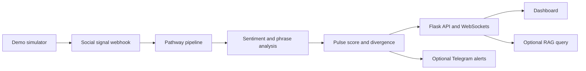

# Echo — Crypto Narrative Pulse Tracker

<p>
  
  
  
</p>

<p>
  <a href="https://skillicons.dev"></a>
</p>

A streaming analytics project that turns social signals into a compact view of emerging crypto narratives. It combines message ingestion, sentiment analysis, phrase clustering, influencer signals, and price/sentiment divergence into a live dashboard and alerting workflow.

## ✨ What it does

- Ingests social messages through a webhook and processes them through a Pathway-based pipeline.
- Scores sentiment with VADER and a crypto-oriented lexicon.
- Groups recurring phrases to surface developing narratives.
- Combines sentiment, phrase momentum, and influencer signals into a pulse score.
- Compares narrative sentiment with market price movement to identify divergence.
- Exposes metrics over HTTP and WebSockets, with optional Telegram alerts.
- Includes a simulator for repeatable demonstrations without a live message source.

## 🏗️ Architecture



## 🧰 Stack

Python · Pathway · Flask · VADER · WebSockets · Next.js · Ollama (optional) · Telegram Bot API

## 🚀 Run with Docker

### Prerequisites

- Docker Engine
- Docker Compose

### Start the pipeline

```bash
git clone https://github.com/SSRINIBASS/echo.git
cd echo
docker compose up --build pipeline
```

The API and webhook service are exposed on ports `8000` and `8080` by default.

### Run the demo simulator

In another terminal:

```bash
docker compose --profile demo run --rm simulator
```

### Start the dashboard and Telegram bot

Configure the required environment variables in a local `.env` file, then run:

```bash
docker compose --profile full up --build
```

### Optional local LLM

```bash
docker compose --profile llm up -d ollama
```

## 🧪 Tests

Run the Python test suite:

```bash
python -m pytest tests/ -v
```

The repository README reports 153 tests across core pipeline, sentiment, pulse score, phrase clustering, influencer tracking, and performance monitoring.

## 🔐 Notes

The full Pathway pipeline is intended to run in the Linux container environment. A local simulator/demo path is provided for development and walkthroughs. External API credentials belong in local environment configuration, never in committed files.
